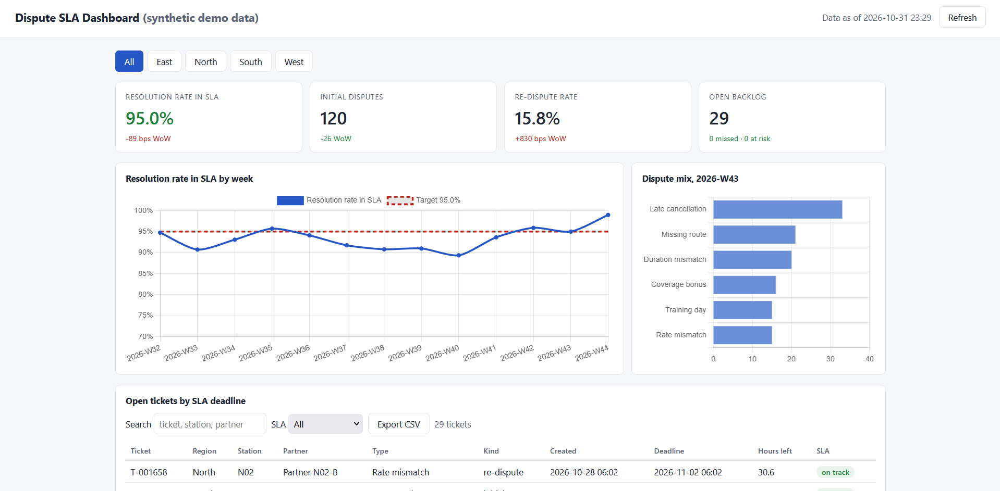
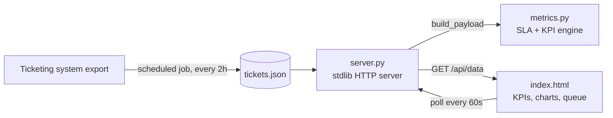

# Dispute SLA Dashboard

A self-refreshing operations dashboard that tracks how fast partner payment
disputes are resolved against a 3-business-day SLA, across regions and weeks.

> All data in this repository is synthetic. Stations, partners, ticket IDs and
> people are generated by `generate_sample_data.py`.

<!-- Screenshot: run the dashboard, capture the page, save it as docs/dashboard.png, then remove this comment line and the arrows around the next line. -->
<!--  -->

## The problem

Dispute resolution was tracked in a weekly spreadsheet built by hand from a
ticketing-system export. By the time the report was ready, SLA breaches were
already days old, every region had its own version of the numbers, and the
metric definitions drifted between people.

## What I built

- **One metric engine** (`metrics.py`) that derives every KPI from raw ticket
  rows: business-day SLA deadlines, met / missed / at-risk status, resolution
  rate in SLA, re-dispute rate and dispute mix. No hand-computed numbers.
- **A zero-dependency backend** (`server.py`, Python standard library only) that
  recomputes everything on each request. A pipeline only has to overwrite one
  JSON file to refresh the dashboard: no restart, no code change.
- **A single-page dashboard** (`static/index.html`): region tabs, KPI cards with
  week-over-week deltas in basis points, a trend chart against target, dispute
  mix, and an open-ticket queue sorted by SLA deadline with search, filters and
  CSV export. It auto-refreshes every 60 seconds.
- **Scheduled refresh** in the original deployment: a background task pulled
  new ticket data every 2 hours and a watchdog restarted the server if it
  stopped, so the dashboard was always current without anyone running it.

## Architecture



## Metric definitions

| Metric | Definition |
|---|---|
| SLA deadline | 3 business days (Mon–Fri) after ticket creation |
| Resolution rate in SLA | met / (met + missed); open tickets still inside SLA are excluded until they resolve or breach |
| Re-dispute rate | re-disputes / initial disputes in the same week |
| At risk | open and less than 24 hours to deadline |

## Run it

```bash
python generate_sample_data.py   # optional: the server creates data on first run
python server.py                 # open http://127.0.0.1:8080
python -m unittest discover -s tests
```

Requires Python 3.10+. No packages to install (Chart.js loads from a CDN).

## Impact (original deployment)

- Replaced a manual weekly report: **~5 hours per week** (~240 hours a year) of reporting time freed up.
- SLA breaches surfaced **the same day** instead of at the weekly review, so at-risk tickets were chased before they missed.
- One shared KPI definition across **4 business lines in 2 regions**, ending "whose number is right" debates.
- Runs unattended: refresh every 2 hours, self-restarting server, previous good data kept if a refresh fails.

## Skills shown

Python · KPI design · SLA / business-day logic · REST API · vanilla JavaScript ·
Chart.js · data visualisation · scheduled automation · unit testing
