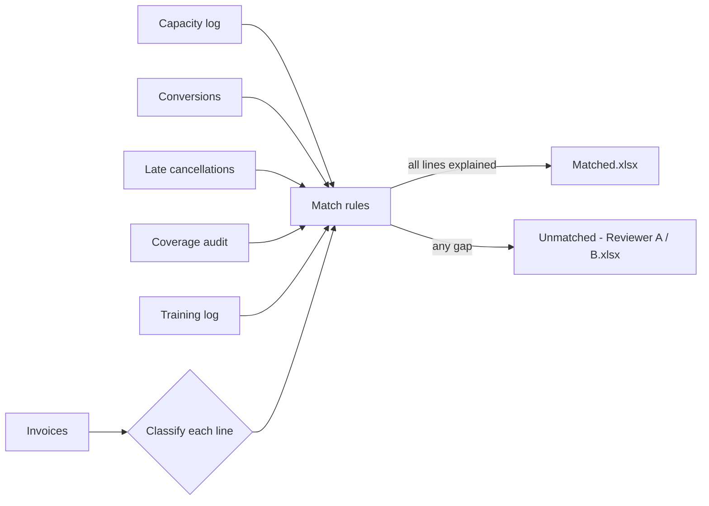

# Invoice Reconciliation Engine
**[▶ Live demo](https://sharmaprateek303-afk.github.io/operations-automation-portfolio/reconciliation/)**

A rule engine that validates every line of a delivery partner's weekly invoice
against the operational feeds that should explain it, and produces review-ready
Excel workbooks: matched invoices in one file, exceptions split across
reviewers.

> All data in this repository is synthetic, generated by `generate_sample_data.py`.

## The problem

Each week, partner invoices had to be checked line by line against several
separate logs: route capacity, late cancellations, coverage bonuses, training
days and service-type conversions. The check was manual: open the invoice,
filter each log, count, compare, note the gap. Across hundreds of invoices a
week it took **~50 hours** of team time, and the results varied by reviewer.

## What I built

- **A classifier** that maps each invoice line to its evidence source from the
  line's description (service type, block duration, line type).
- **Matching rules per line type** (`recon.py`):

  | Line type | Evidence | Rule |
  |---|---|---|
  | Capacity routes | capacity log + conversions | row count per site / partner / service / duration, netted for routes converted to another service type |
  | Late cancellations | cancellation log | sum of counts |
  | Coverage bonus | coverage audit | coverage added; **fallback** adds coverage still pending a quality check |
  | Training days | training log | one row per trained associate |
  | Fuel allowance | none | excluded (pass-through) |

- **Three-state outcome per invoice:** `Y` (fully explained), `Y (fallback)`
  (explained once the quality-check fallback is applied) and `N` (needs a human).
- **Reviewer-friendly output** (`report.py`): Summary sheet first, then one sheet
  per invoice with the raw invoice on the left and the validation on the right,
  colour-coded green / blue / red. Exception tabs are red.
- **Workload-balanced review queues:** exceptions are split across reviewers by
  number of open lines, not just invoice count, so the effort is even.

## How it works



## Run it

```bash
pip install -r ../requirements.txt
python generate_sample_data.py
python run.py --reviewers "Reviewer A,Reviewer B"
python -m unittest discover -s tests
```

Sample run on the synthetic data:

```
  Reviewer A: 9 invoices, 9 lines to review
  Reviewer B: 8 invoices, 8 lines to review
Invoices: 60 | N: 17 | Y: 37 | Y (fallback): 6
Lines validated automatically: 291/308 (94%)
```

## Impact (original deployment)

- Weekly reconciliation effort cut from **~50 hours to ~12 hours**
  (≈ **1,800 hours a year**, roughly one full-time analyst's capacity).
- **~80% of invoices** cleared automatically; reviewers only see the exceptions.
- The quality-check fallback rule alone cleared **about 1 in 5** of the invoices
  that would otherwise have gone to manual review.
- Faster, consistent checks mean overbilling is caught before payment, not after.
- Every decision is traceable: each line shows the evidence count it was matched against.

## Skills shown

Python · rules engines · data reconciliation · CSV / JSON processing ·
openpyxl Excel automation · workload balancing · finance operations ·
unit testing
