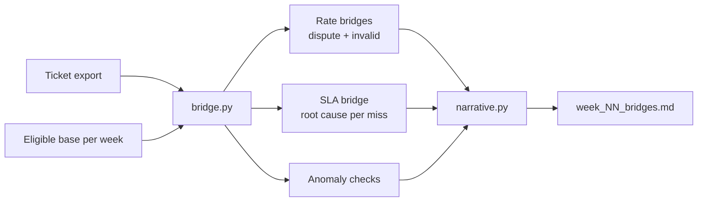

# Weekly Business Review Bridges

Automates the weekly "why did the metric move?" analysis for a leadership
business review. From raw dispute tickets it computes three metrics per
business line, splits each week-over-week change into the drivers that caused
it, finds the root cause of every SLA miss, and writes the review document.

> All data in this repository is synthetic. The demo data has two planted
> stories for the bridge to find: a late-cancellation spike at two sites and a
> site that kept tickets waiting on its input.

## The problem

Every week, someone had to read through each dispute ticket to explain the
movement in dispute rate, invalid-dispute rate and SLA performance before the
leadership review. It was slow, the explanations were hard to check, and
different weeks used different logic.

## What I built

- **Bridge maths** (`bridge.py`). For a rate `r = n / base`, the change is split
  by category `c` as `n_c,cur / base_cur − n_c,prev / base_prev`. The
  contributions add up exactly to the headline change, so the explanation always
  reconciles to the number on the slide.
- **SLA root cause, one per missed ticket**, checked in order of
  accountability: late first response → reopened after resolution → waiting on
  site input → resolved after deadline.
- **Repeat-site flag**: sites with two or more misses caused by waiting on their
  input are called out for follow-up.
- **Data-quality checks** before anything reaches leadership: missing
  denominators, invalid disputes without a reason, likely duplicate submissions.
- **Three outputs from one set of numbers** (`narrative.py`): a leadership
  paragraph, a speakable version for the meeting, and supporting tables.

## Pipeline



## Example output (synthetic data)

> **Line A.** The dispute rate rose 301 bps week over week to 14.3% (127 disputes
> on 888 eligible combinations), driven by Late cancellation (30 to 51, +245 bps)
> and Coverage bonus (3 to 9, +68 bps). … SLA performance was 89.8%, below the
> 95.0% target. Missed tickets break down as 10 waiting on site input, 3 late
> first response. Site UK03 (5 misses) held tickets waiting on its input and is
> flagged for follow-up.

| Driver | Prev wk | This wk | Contribution (bps) |
|---|---:|---:|---:|
| Late cancellation | 30 | 51 | +245 |
| Coverage bonus | 3 | 9 | +68 |
| Missing route | 23 | 17 | −61 |
| … | | | |
| **Total** | **103** | **127** | **+301 bps** |

## Run it

```bash
python generate_sample_data.py
python run.py            # writes output/week_43_bridges.md
python -m unittest discover -s tests
```

Python standard library only.

## Impact (original deployment)

- Weekly review prep cut from **~7 hours to ~30 minutes** (≈ 300 hours a year).
- Every movement explained with drivers that reconcile to the headline number,
  so leadership questions get answered in the meeting, not in a follow-up.
- Repeat SLA offenders surfaced by name each week, giving site leads a clear,
  evidence-backed list to act on.

## Skills shown

Python · metric decomposition · root-cause analysis · business-day SLA logic ·
data-quality checks · automated reporting · executive communication
