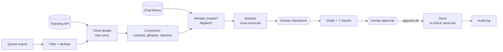

# Human-in-the-Loop Outreach Agent

**[▶ Live demo](https://sharmaprateek303-afk.github.io/operations-automation-portfolio/outreach/)**

An AI agent that chases site contacts for the inputs needed to resolve
partner-payment disputes before the SLA runs out. It reads every ticket,
works out who to contact, checks the chat history, drafts the messages and
stops for approval. **Nothing is sent until a person says so.**

> All data in this repository is synthetic: sites, partners, people and tickets
> are generated by `generate_sample_data.py`. The original agent ran on an
> enterprise LLM agent platform with ticketing and chat integrations; this is
> a clean Python re-implementation of the same rules.

## The problem

Disputes stall when the site that has the answer doesn't reply. Three times a
day, someone had to open every waiting ticket, read the thread, work out who
had been tagged, check whether they'd already been chased in chat, and send a
reminder. It was slow, and the risks were real: messaging the wrong person,
chasing someone who'd already replied, or quietly missing a ticket.

## What I built

An agent that follows a written runbook, with the risky decisions taken away
from it and given to a human.

| Step | What the agent does |
|---|---|
| 1. Queue | Loads the export, filters to the severity, removes duplicates and reports how many |
| 2. Details | Fetches each ticket; retries once, then parks it as "Could not process" with the reason |
| 3. Comments | Finds the contacts the ops team tagged (latest tag set), a ~250-character glimpse of the latest comment, and any rejection (full, partial or unclear) |
| 4. Chat | Checks what was sent since yesterday and whether a **contact** (not a teammate) replied |
| 5. Buckets | Every ticket lands in exactly one bucket; the counts must add up to the total |
| **Checkpoint** | A person reviews the buckets, flags and open questions |
| 6. Drafts | Locked templates; **7 automated checks** on every message |
| **Approval** | Explicit "approve all" or edits; otherwise nothing is sent |
| 7. Send | Re-checks the never-message list immediately before each send |
| 8. Log | Appends an audit log of the run: who was messaged, who wasn't, and why |

### Guardrails (`rules.py`)

- **Never sends without approval.** The send step takes an approval callback and does nothing without it.
- **Never-message list** enforced at draft time and again at send time, including @mentions.
- **Never guesses.** No tagged contact means "No contact identified, please advise", not a best guess.
- **Never drops a ticket.** An assertion fails the run if bucket counts don't reconcile.
- **Never decides unclear cases.** A reopened or ambiguous rejection is flagged for a human.
- **Never rewords a template.** Only the link changes; the check compares against the template byte for byte.
- **Runs only on schedule.** An unscheduled severity or run type is refused with a question.

### Pre-send checks (every draft)

1. Link is `https://` and uses the ticket reference, followed by a space
2. Recipients present, no duplicates, no bots
3. No team member, except the SEV-1 copy of the last commenter
4. No never-message person anywhere
5. Text matches the locked template exactly
6. Not already messaged in this run window
7. Latest-comment glimpse shown to the approver

## Architecture



## Run it

```bash
python generate_sample_data.py
python run.py                 # stops and asks: type "approve all" to send
python run.py --approve-all   # demo mode
python -m unittest discover -s tests
```

Python standard library only. `mock_clients.py` stands in for the ticketing and
chat APIs, so real clients drop in without touching the agent logic.

## Impact (original deployment)

- Three daily outreach runs that took **~1.5 hours a day** by hand now take
  **~15 minutes** of human review (≈ **300 hours a year**).
- **Every waiting ticket accounted for** in every run: none silently missed.
- **Zero messages to excluded people**, and no duplicate chasing of contacts who had already replied.
- Faster site replies, so fewer disputes miss SLA while "waiting on site input".

## Skills shown

AI agents · human-in-the-loop design · LLM guardrails · workflow automation ·
chat-ops · ticketing integrations · Python · testing · audit logging
